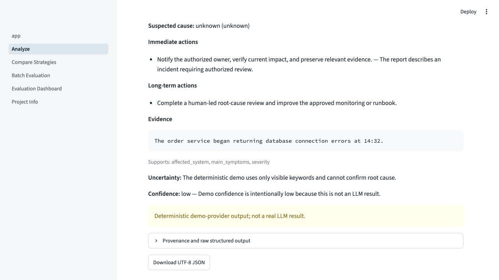
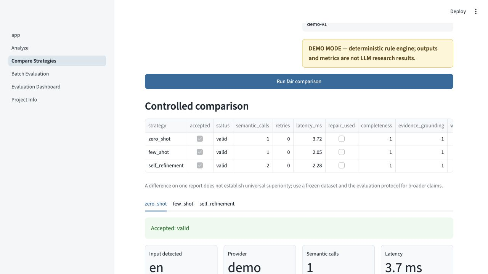
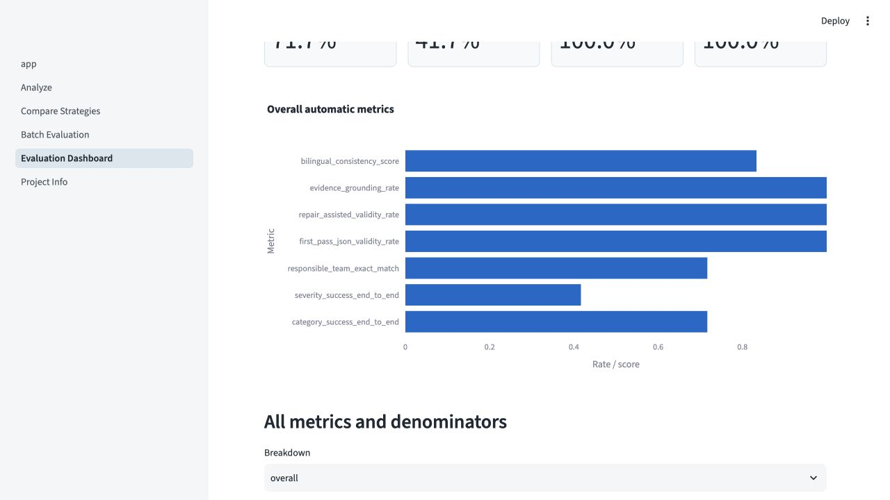
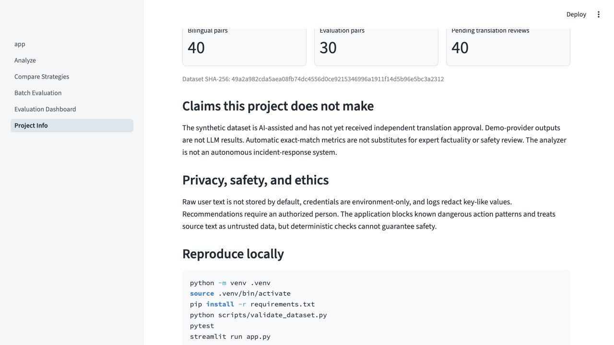

# Bilingual Industrial Incident Analyzer

A provider-neutral Streamlit application that converts English or Simplified Chinese
technical incident reports into strict, evidence-grounded JSON, then compares three
prompting strategies under a reproducible evaluation protocol.

> **Status:** implementation and deterministic demo evaluation are complete locally.
> Live LLM experiments are pending a configured provider, two-call safety check, cost
> review, and explicit approval. The bundled translations are AI-assisted drafts with
> `pending_manual_review` status.

## Safety warning

This project is research and decision-support software, not an autonomous incident
response system. Recommendations can be incomplete or wrong. An authorized human must
review operational changes, especially changes involving production, security, hardware,
or physical safety. Never paste credentials or confidential reports into an unapproved
provider.

## What it demonstrates

- English and Chinese input with English or Chinese output: `en→en`, `en→zh`,
  `zh→en`, and `zh→zh`.
- Strict Pydantic v2 output with controlled categories, severity, teams, uncertainty,
  actions, and verbatim evidence.
- Zero-shot, development-only few-shot, and one-cycle self-refinement prompts.
- Provider isolation: core services do not import a vendor SDK.
- Deterministic offline demo mode plus an optional OpenAI-compatible live adapter.
- Exact-substring evidence validation, suspicious-detail warnings, language checks, and
  dangerous-action patterns.
- Bounded transport retries, one optional JSON repair, complete attempt attribution, and
  no infinite loops.
- SQLite run storage, frozen manifests, stable task IDs, checkpointed stopping, resume,
  UTF-8 JSON/CSV export, and denominator-aware metrics.
- A balanced 40-pair / 80-report synthetic bilingual dataset with a held-out evaluation
  split and automated leakage checks.

## Screenshots

Actual app screenshots are stored in [`screenshots/`](screenshots/) and indexed in
[`docs/screenshot_manifest.md`](docs/screenshot_manifest.md). Every screenshot uses the
deterministic provider and is visibly labeled **DEMO MODE**; none is represented as a
real LLM result.

| Evidence-grounded analysis | Controlled strategy comparison |
|---|---|
|  |  |

| Held-out dashboard with denominators | Claims and safety boundaries |
|---|---|
|  |  |

## Prompt strategies in simple language

| Strategy | Plain-language meaning | Semantic calls per report |
|---|---|---:|
| Zero-shot | Give the task, safety rules, and JSON schema without a worked example. | 1 |
| Few-shot | Add four development-only worked examples so the format and labels are concrete. | 1 |
| Self-refinement | Create an initial answer, review validation feedback, and produce one corrected answer. | 2 |

The project asks which strategy is most accurate, consistent, grounded, and structurally
valid for this bounded bilingual dataset. A result on one report is never treated as proof
that a strategy is universally better.

## Architecture

```text
Streamlit / CLI
      |
AnalysisService + BatchService
      |
PromptManager -- provider protocol -- demo or OpenAI-compatible adapter
      |
strict JSON parser
      |
Pydantic schema + language + evidence + suspicious-detail + safety validation
      |
SQLite records + JSON/CSV exports + automatic metrics + manual-review sheet
```

The provider boundary keeps vendor-specific calls and errors out of prompts, validation,
storage, metrics, and UI code. See [`docs/architecture.md`](docs/architecture.md).

## Repository structure

```text
.
├── app.py                     # Streamlit entry page
├── pages/                     # Analyze, compare, batch, dashboard, project info
├── src/
│   ├── domain/                # enums and provider-neutral records
│   ├── schemas/               # strict Pydantic contracts
│   ├── prompts/               # prompt rendering and hashes
│   ├── providers/             # deterministic and live adapters
│   ├── validation/            # parser, schema, evidence, safety, language
│   ├── services/              # analysis, comparison, batch orchestration
│   ├── evaluation/            # dataset, tasks, metrics, review export
│   └── storage/               # SQLite schema and repositories
├── prompts/                   # versioned prompt templates and dev examples
├── data/                      # versioned JSONL/CSV dataset and manifest
├── tests/                     # zero-network unit and integration tests
├── scripts/                   # validate, evaluate, export, secret scan
├── results/                   # exported, clearly labeled artifacts
├── screenshots/               # actual local-app captures and manifest links
└── docs/                      # specification and operational documentation
```

## Quick start

Python 3.11 or later is required.

```bash
git clone https://github.com/Zaineb-Gharib/bilingual-industrial-incident-analyzer.git
cd bilingual-industrial-incident-analyzer
python3 -m venv .venv
source .venv/bin/activate        # Windows PowerShell: .venv\Scripts\Activate.ps1
python -m pip install -r requirements.txt
python scripts/validate_dataset.py
streamlit run app.py
```

Open the local address printed by Streamlit. Demo mode works offline after installation
and makes no API calls.

## Configuration

Copy the example only when you want local overrides:

```bash
cp .env.example .env
```

| Variable | Purpose | Safe default |
|---|---|---|
| `LLM_PROVIDER` | `demo` or `openai_compatible` | `demo` |
| `LLM_MODEL` | Provider model identifier | `demo-v1` |
| `LLM_API_KEY` | Local credential; never committed | empty |
| `LLM_BASE_URL` | Optional compatible API base URL | empty |
| `LLM_TIMEOUT_SECONDS` | Per-request timeout | `30` |
| `LLM_MAX_RETRIES` | Retryable transport retries | `2` |
| `LLM_TEMPERATURE` | Sampling temperature | `0` |
| `APP_STORE_RAW_INPUTS` | Persist user report text | `false` |
| `APP_DATABASE_PATH` | Local SQLite path | `data/local/app.db` |
| `LOG_LEVEL` | Application log level | `INFO` |

The adapter accepts a configurable model name because model availability changes. Check
the provider's current documentation rather than copying an old identifier. The official
OpenAI [model catalog](https://developers.openai.com/api/docs/models) and
[model comparison](https://developers.openai.com/api/docs/models/compare) are the current
starting points for that provider. More detail is in
[`docs/provider_configuration.md`](docs/provider_configuration.md).

## Demo provider

`LLM_PROVIDER=demo` is the default. It is a deterministic keyword/rule engine designed for
tests, UI verification, and portfolio walkthroughs. Every result includes a warning saying
that it is not a real LLM result. Demo metrics test the pipeline; they do not measure model
quality.

## Live provider safety gate

1. Put the credential only in local `.env` or the shell environment.
2. Select `openai_compatible` and an available model.
3. Run no more than two small synthetic examples first.
4. Confirm authentication, JSON output, evidence validation, token usage, and latency.
5. Estimate the full request volume: evaluation has 180 outputs and 240 base semantic
   calls; retries and repair can increase that number.
6. Review current provider pricing and obtain explicit approval before a live batch.

The CLI refuses a live batch without `--approve-live-batch`. The UI requires the exact
phrase `APPROVE LIVE BATCH` after showing the request estimate. This flag records consent;
it cannot guarantee a bill because token usage and provider pricing vary.

## Dataset

The source of truth is [`data/incidents_v1.jsonl`](data/incidents_v1.jsonl).

- 40 paired scenarios / 80 language-specific reports.
- Ten categories, four pairs per category.
- 10 development pairs and 30 held-out evaluation pairs; translations never cross splits.
- English and Simplified Chinese reports, gold concepts, evidence spans, provenance, and
  conservative safety notes.
- No real companies, people, IP addresses, credentials, or confidential identifiers.
- AI-assisted draft authoring; all 40 translation pairs remain pending independent review.
- SHA-256:
  `49a2a982cda5aea08fb74dc4556d0ce9215346996a1911f14d5b96e5bc3a2312`.

The CSV is encoded with a UTF-8 byte-order mark for common spreadsheet tools. Validation
checks record schemas, evidence substrings, IDs, balance, split integrity, development-only
prompt examples, and high lexical overlap. See [`docs/dataset_card.md`](docs/dataset_card.md).

## Evaluation

```bash
# Fast deterministic development run: 60 outputs / 80 base semantic calls
python scripts/run_evaluation.py --provider demo --model demo-v1 --split development

# Restrict a run to one or more paths
python scripts/run_evaluation.py --provider demo --split evaluation \
  --language-path en\-\>zh --language-path zh\-\>zh

# Export one persisted run
python scripts/export_results.py RUN_ID
```

Automatic metrics include category and severity conditional accuracy plus end-to-end
success, responsible-team exact match, symptom precision/recall/F1, first-pass JSON
validity, repair-assisted validity, required-field completion, evidence grounding,
evidence quote hallucination, bilingual consistency, failure rate, and latency. Every
metric stores its numerator, denominator, exclusions, source, version, and group.

Manual rubric scores are separate from automatic metrics. They are not populated until a
reviewer actually completes the blinded sheet. See
[`docs/evaluation_report.md`](docs/evaluation_report.md) and
[`docs/manual_review_guide.md`](docs/manual_review_guide.md).

### Executed deterministic demo run

Run `run-7343b258a9b64a77bc4716bd15d07445` completed all 180 held-out outputs on
2026-07-14. It used `demo-v1`, not an LLM. These measurements validate the research
plumbing and expose the rule engine's limitations; they are not model-performance claims.

| Automatic demo metric | Result | Denominator |
|---|---:|---:|
| Final accepted validity | 100.0% | 180 outputs |
| First-pass JSON + schema validity | 100.0% | 180 outputs |
| JSON repair use | 0.0% | 180 outputs |
| Category end-to-end success | 71.7% | 129/180 outputs |
| Severity end-to-end success | 41.7% | 75/180 outputs |
| Responsible-team exact match | 71.7% | 129/180 parsed outputs |
| Evidence quote grounding | 100.0% | 180/180 returned quotes |
| Evidence quote hallucination | 0.0% | 0/180 returned quotes |
| Symptom micro-F1 | 0.000 | 360 counted TP/FP/FN units |
| Bilingual consistency | 0.833 | 90 matched source-language pairs |
| Failure rate | 0.0% | 180 outputs |
| Average / median / p95 latency | 1.44 / 1.15 / 2.58 ms | 180 outputs |

The symptom score is zero because the deterministic provider emits generic descriptions
rather than the dataset's normalized gold concepts. Latency measures local rule execution,
so it must not be compared with network-model latency. Full records are in
[`results/processed/`](results/processed/); manual-review fields remain blank.

## Quality checks

The default suite makes zero network calls:

```bash
ruff format --check .
ruff check .
pytest --cov=src --cov-report=term-missing
python scripts/validate_dataset.py
python scripts/check_secrets.py
```

The CI workflow runs formatting, lint, all tests, dataset validation, and the project secret
scan on pushes and pull requests.

## Privacy and storage

- Raw user input is not stored unless `APP_STORE_RAW_INPUTS=true` or a versioned synthetic
  batch explicitly overrides it.
- Provider raw responses are stored for reproducibility; choose an approved provider and
  retention policy before using sensitive material.
- API keys are not part of settings summaries, logs, SQLite records, exports, tests, or
  screenshots.
- `.env`, local SQLite databases, caches, and raw experimental artifacts are ignored by Git.

## Limitations

- No live LLM result is included until the live-call gate is completed.
- The dataset is small and synthetic; it cannot establish real-world generalization.
- Chinese translations and labels await independent human review.
- Keyword language detection and deterministic safety patterns are useful checks, not
  guarantees.
- Exact evidence matching rewards traceability but does not prove the conclusion is correct.
- Bilingual consistency can be high when two outputs are consistently wrong.
- Automatic metrics do not replace domain-expert factuality, operational safety, or
  translation assessment.
- The OpenAI-compatible adapter uses JSON-object mode plus local strict validation; provider
  compatibility can vary by endpoint and model.

## Future work

- Obtain independent bilingual and domain-expert review for the 40 translation pairs and
  blinded output rubric.
- Run the two-call live-provider safety check, document observed usage, estimate cost from
  current pricing, and request approval before the full held-out experiment.
- Compare additional provider adapters only after adding provider-specific contract tests.
- Expand the synthetic corpus and test robustness to longer, noisier, and mixed-language
  reports without weakening the evidence-grounding rules.
- Add calibrated confidence analysis only after enough human-reviewed outcomes exist.

## Interview walkthrough

1. Start in demo mode and explain why honest offline behavior matters.
2. Analyze one English report in Chinese and point to the exact source quote.
3. Open the validation panel and explain schema, grounding, and safety checks.
4. Compare the three strategies; emphasize controlled conditions and the extra call used by
   self-refinement.
5. Prepare a development batch and show its frozen hash, stable task IDs, request estimate,
   checkpointed stopping, and resume behavior.
6. Open the dashboard, state clearly that the visible metrics are demo-pipeline metrics, and
   show denominators and grouped breakdowns.
7. Finish with limitations and the concrete live-evaluation gate. This demonstrates both
   engineering judgment and research integrity.

## Contributing and license

See [`CONTRIBUTING.md`](CONTRIBUTING.md). Released under the [MIT License](LICENSE).
